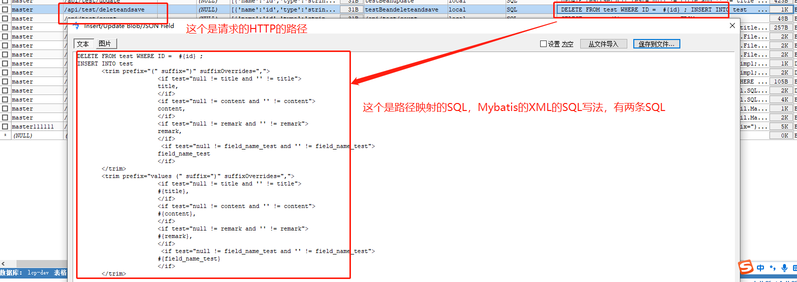
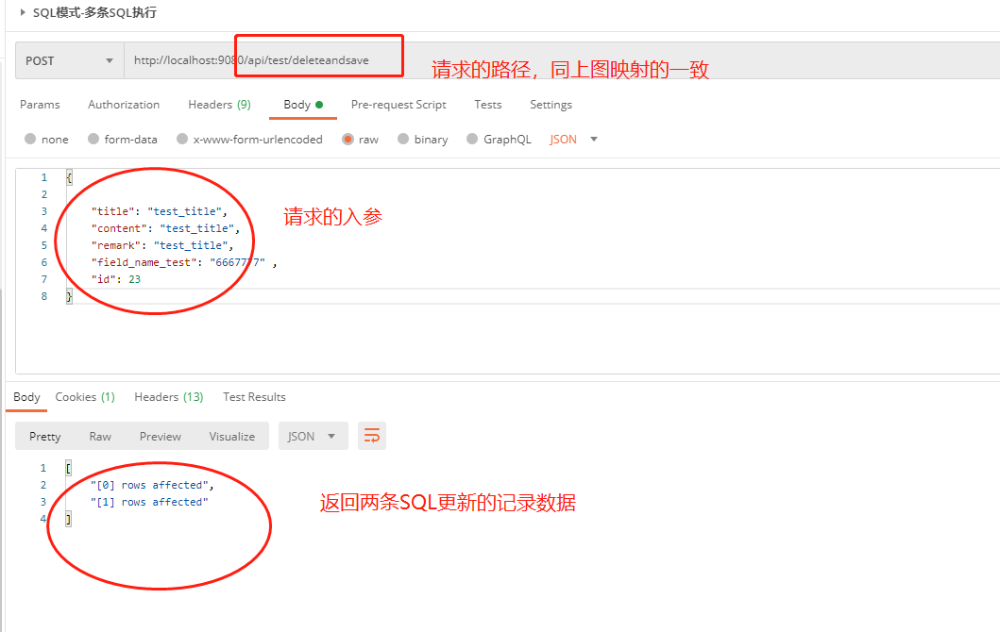
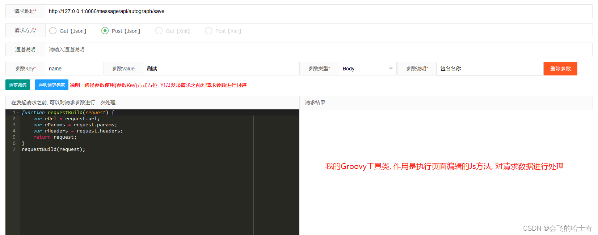
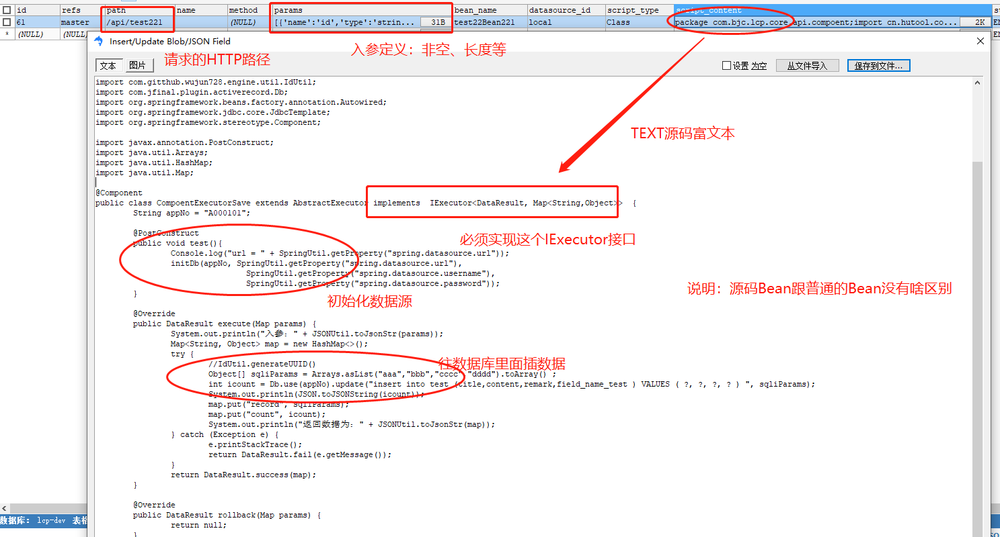
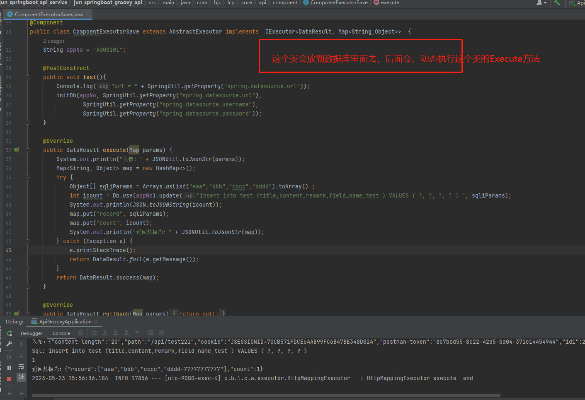
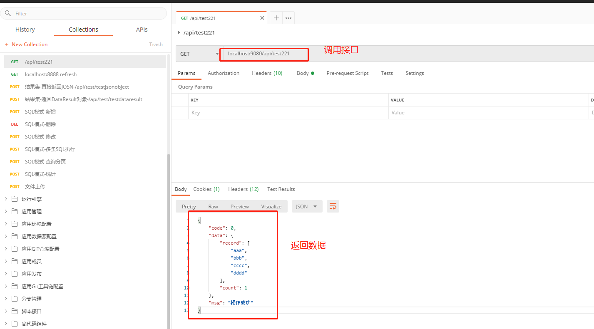
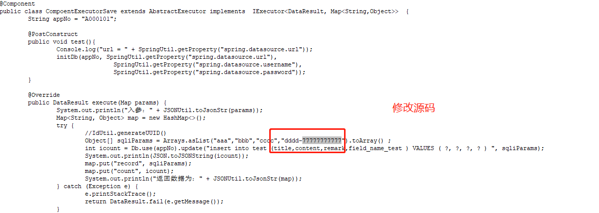
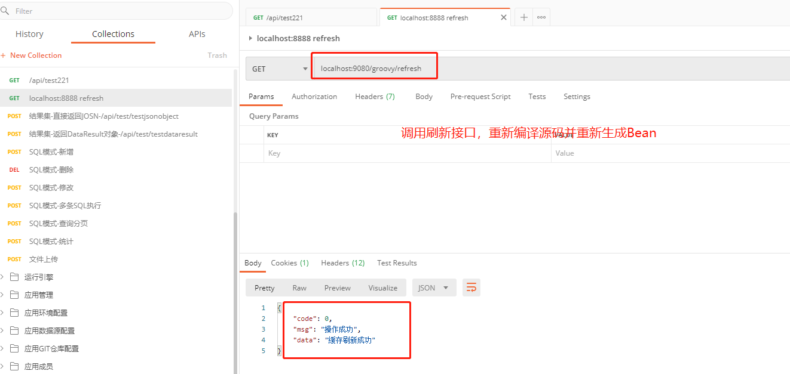
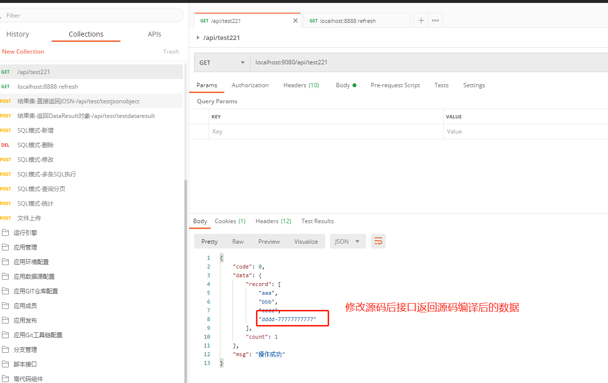

# jun-groovy-api-spring-boot-starter

jun-groovy-api-spring-boot-starter是低代码开发平台开发stater基座，基于SpringBoot项目都可以嵌入支持。项目基于SpringBoot+Groovy+SQL动态生成API并动态发布，且发布后可动态执行groovy脚本及SQL脚本的Stater。提供在线执行动态程序脚热加载本及动态生成API并执行的功能。支持动态注册Mapping，动态生成类及源码并动态编译生成Bean，**可动态生成HTTP接口。支持在线编辑写好SQL或者Java源码、Groovy源码、Python源码（TODO），JavaScript源码（TODO）、Shell脚本，后即可快速生成Rest接口对外提供服务**，同时支持服务在线热加载在线编辑替换逻辑，还将提供了一键生成CRUD通用接口方法，减少通用接口的SQL编写，让开发人员专注更复杂的业务逻辑实现。支持有JDBC驱动的的数据源(Java支持的都可以支持)。后续将集成微服务注册中心、网关支持接口转发、黑白名单、权限认证、限流、缓存、监控等提供一站式API服务功能。

说明：本项目仅是一个Stater，无法独立运行（通用模块），需要嵌入到jun_springboot_api_service中jun_springboot_groovy_api独立模块（定制模块）才能运行。

The project is based on SpringBoot+Groovy to dynamically generate APIs and publish them, and can dynamically execute Groovy scripts and SQL scripts' Staters after publication. Provide online execution of dynamic scripts class and hot loader and dynamic API generation and execution functions.


# 使用教程

- 在自己的maven项目中**引入maven坐标（已发布中央仓库）**
```xml
<dependency>
    <groupId>io.github.wujun728</groupId>
    <artifactId>jun-groovy-api-spring-boot-starter</artifactId>
    <version>1.0.2-RELEASE</version>
</dependency>
```

- 核心api - **Step1-加载源码生成类及SpringBean**
```
Class clazz = groovyClassLoader.parseClass(groovyInfo.getGroovyContent());
BeanDefinitionBuilder builder = BeanDefinitionBuilder.genericBeanDefinition(clazz);
BeanDefinition beanDefinition = builder.getBeanDefinition();
registry.registerBeanDefinition(groovyInfo.getBeanName(), beanDefinition);
```

- 核心api - **Step2-动态生成SpringMapping映射HTTP服务及接口（无需手写Mapping接口）**
```
// 取消历史注册
requestMappingHandlerMapping.unregisterMapping(mappingInfo);
// 重新注册mapping
requestMappingHandlerMapping.registerMapping(mappingInfo, mappingFactory, targetMethod);
}
```


- 核心api - **Step3-执行分N种实现，目前实现三种；SQL脚本模式、Java源码模式、Groovy源码**
Python源码（TODO），NodeJS源码（TODO），Shell(TODO)、PHP(TODO)、PowerShell(TODO)等类型脚本(JVM支持的都可以支持), 具体见注入mapping的method方法；
```
// 源码解析并执行
switch (config.getScriptType()) {
case "SQL":
	data = doSQLProcess(config, request, response);
	break;
case "Class":
	data = doGroovyProcess(config, request, response);
	break;
case "Groovy": 
	data = doGroovyProcess(config, request, response);
	break;
case "Jython": // TODO
	data = doPythonProcess(config, request, response);
	break; // TODO
case "Javascript": // TODO
	data = doNodeJSProcess(config, request, response);
case "Jruby":// TODO
	data = doRubyProcess(config, request, response);
	break;
default:
	break;
}

// SQL源码执行（SQL脚本支持mybatis写法及原生写法）
SqlMeta sqlMeta = JdbcUtil.getEngine().parse(apiSql.getSqlText(), sqlParam); 
Object data = JdbcUtil.executeSql(connection, sqlMeta.getSql(), sqlMeta.getJdbcParamValues());
dataList.add(data);

// Java源码执行（实现IExecutor接口，支持定制不同的接口，一般情况下也够用了）
String beanName = GroovyInnerCache.getByPath(config.getPath());//请求Path映射Bean名称
Map<String, Object> params = getParams(request, config);//获取Request参数转Map
IExecutor bean = SpringUtil.getBean(beanName);//调用Bean
return bean.execute(params);//返回Bean结果集

//其他源码执行（使用ScriptEngineManager来执行），举例JS如下，其他的还没来得及整,TODO中
ScriptEngineManager manager = new ScriptEngineManager();
ScriptEngine engine = manager.getEngineByName("javascript");
//向engine中存值
engine.put("str", "jsEnginePutTest");
engine.eval("var output ='' ;for (i = 0; i <= str.length; i++) {  output = str.charAt(i) + output }");     

```

# 示例

**Step1-启动的时候会读取api_config表中的记录并注册为Bean**

```

开始解析groovy脚本...
c.g.w.e.g.core.bean.GroovyDynamicLoader  : 当前groovyInfo加载完成,className-testdataresult,path-/api/test/testdataresult,beanName-testdataresult,BeanType-Class：
c.g.w.e.g.core.bean.GroovyDynamicLoader  : 当前groovyInfo加载完成,className-test22Bean1,path-/mobile/api/test22,beanName-test22Bean1,BeanType-Class：
结束解析groovy脚本...，耗时：1398

```

- **Step2，择取上面启动的两个示例：SQL示例（api_config里面插一条SQL类型的接口数据就可以了）**
### SQL开发及定义

**Step1，在数据库新增SQL接口**



**Step2，执行SQL接口**



**Step3、在线编辑接口及测试接口（TODO）**



#### Java源码接口开发

**Step1，在API_CONFIG表中新增一条数据映射成下面的类的解析，SQLyog数据及类的源码展示，具体如下**





**Step2，在POSTMAN中通过PATH，调用这个类，并Java源码解析后执行结果集返回的数据**



**Step3，不重启JVM，手动修改源码**（即使修改幅度非常大也没问题，只要能编译成功就可以）



**Step4，调用缓存刷新Refresh接口，重新初始化Bean及缓存**



**Step5，在POSTMAN中通过PATH，再次调用这个类，执行结果集返回的数据是最新编译的**



---

## 更新记录

### 2026-03-21 jun_dbapi 插件系统升级（v2.3.1 → v4.0插件兼容）

**概述：** 将 `dbapi/` 目录下16个v4.0插件搬迁到 `jun_dbapi/jun-dbapi-plugin/` 目录下，每个插件作为独立Maven子模块，可单独编译成JAR包。同时升级 `jun_dbapi` (v2.3.1) 的插件框架以兼容v4.0的6种插件接口。

**修改内容：**

1. **升级插件框架接口 (`dbapi-plugin` 模块)**
   - 新增 `BasePlugin` 接口（`getName()`, `getDescription()`, `getParamDescription()`）
   - 新增4个插件抽象类：`AlarmPlugin`（告警）、`GlobalTransformPlugin`（全局转换）、`ParamProcessPlugin`（参数处理）、`ParameterValidator`（参数校验）
   - 升级 `CachePlugin` 和 `TransformPlugin` 签名，支持 `localPluginParam` 参数
   - 重写 `PluginManager`，从 `Class.forName` 改为 Java SPI (`ServiceLoader`) 加载6种插件

2. **更新数据模型 (`dbapi-common` 模块)**
   - `ApiConfig` 新增8个插件字段（alarm/globalTransform/paramProcess/parameterValidator 的 Plugin 和 Params）
   - `ResponseDto` 新增 `getSuccess()` 方法兼容v4.0插件调用

3. **更新数据库Schema (`dbapi-assembly/sql/`)**
   - MySQL 和 SQLite DDL 文件 `api_config` 表新增8个插件字段

4. **新建 `jun-dbapi-plugin` 多模块项目（16个独立JAR插件）**
   - 数据转换插件：advanced-tree-format, camel-rename, date-format, encrypt, single-value-extract, tree-format
   - 全局转换插件：amis-global-transform, data-extract
   - 参数处理插件：aes-param-decrypt, pagination, string-concat
   - 告警插件：dingtalk-alarm, email-alarm, feishu-alarm
   - 缓存插件：memory-cache（基于Caffeine）
   - 参数校验插件：sign（MD5签名校验）

5. **更新后端逻辑 (`dbapi-core` 模块)**
   - 新增 `PluginInitializer`（`@PostConstruct` 初始化插件）
   - 新增 `PluginController`（`GET /plugin/all` 返回已加载插件列表）
   - 重写 `ApiInterceptor` 执行管线：参数校验 → 参数处理 → 缓存查询 → SQL执行 → 数据转换 → 缓存写入 → 全局转换 → 异常告警

6. **更新前端UI (`dbapi-ui`)**
   - `common.vue` 支持6种插件类型的下拉选择器+参数输入框（从 `/plugin/all` 动态加载）
   - `add.vue` / `edit.vue` 表单提交包含12个插件字段

7. **修复 JWT 密钥安全漏洞 (T005)**
   - 问题：JWT 签名使用用户密码作为 HMAC secret，攻击者知道密码即可伪造令牌
   - 修复：新增 `dbapi.jwt.secret` 配置项，使用独立的强随机密钥签名/验证 JWT
   - 新增 `JwtConfig` 组件在启动时注入密钥到 `JwtUtils`
   - 修改 `JwtUtils.createToken()`/`verifyToken()` 不再接收外部 secret 参数
   - 影响文件：JwtUtils.java, JwtConfig.java(新增), JwtAuthenticationInterceptor.java, UserController.java, application.properties

8. **修复 Cache.status 线程安全问题 (T006)**
   - 问题：Cache.java 中 status 字段是普通 Map 声明且未初始化，多线程并发读写无同步保护
   - 修复：将 status 字段类型改为 ConcurrentHashMap 并直接初始化，确保线程安全
   - 影响文件：Cache.java

9. **修复 IPService 竞态条件 (T007)**
   - 问题：IPService.detail() 中对 Cache.status 的 check-then-act 模式无同步保护，多线程可同时进入初始化块导致重复查询
   - 修复：Cache.status 加 volatile 关键字保证可见性；detail() 方法使用 double-checked locking 防止并发重复初始化
   - 影响文件：Cache.java, IPService.java

10. **修复 JwtUtils 弱密钥问题 (T008)**
    - 问题：JWT 密钥缺乏强度校验，可能使用过短或默认密钥
    - 修复：JwtUtils.setSecret 增加最小 32 字符长度校验；JwtConfig 启动时验证密钥非空、长度足够，使用默认密钥时输出警告
    - 影响文件：JwtUtils.java, JwtConfig.java

11. **替换 DES 加密为 AES-256-GCM (T009)**
    - 问题：EncrypDES.java 使用已破解的 DES 算法，且密钥每次实例化随机生成，重启后无法解密
    - 修复：算法改为 AES/GCM/NoPadding (256-bit)；密钥从配置文件 dbapi.encrypt.key 加载（Base64 编码 32 字节）；GCM 模式自带认证，每次加密生成随机 IV
    - 影响文件：EncrypDES.java, EncryptConfig.java(新增), application.properties

12. **替换 MD5 密码哈希为 BCrypt (T010)**
    - 问题：密码以明文存储在数据库中，MD5.java 提供的无盐 MD5 哈希同样不安全，易被彩虹表攻击
    - 修复：引入 spring-security-crypto 的 BCryptPasswordEncoder；登录验证改为 Java 层 BCrypt 校验；重置密码存储 BCrypt 哈希；旧明文密码登录成功后自动迁移为 BCrypt
    - 影响文件：PasswordUtil.java(新增), UserService.java, UserMapper.java, dbapi-core/pom.xml

13. **修复 HttpUtil 资源泄漏 (T011)**
    - 问题：HttpUtil 中 HttpClient 和 Response 在异常路径下可能未正确关闭
    - 修复：改用 try-with-resources 确保资源自动释放
    - 影响文件：HttpUtil.java

14. **修复 JwtUtils 空 catch 块 (T012)**
    - 问题：getAudience() 方法中 JWTDecodeException 被静默吞没，无效令牌解码失败时无任何日志记录
    - 修复：空 catch 块改为 log.warn 记录异常信息，便于排查无效令牌问题
    - 影响文件：JwtUtils.java

15. **修复 UUIDUtil 弱 ID 生成 (T013)**
    - 问题：RandomStringUtils.random(8) 生成的短随机串碰撞风险高且可预测
    - 修复：替换为 UUID.randomUUID() 生成 32 位不可预测的唯一标识
    - 影响文件：UUIDUtil.java

16. **修复 IPUtil 重复条件判断 (T014)**
    - 问题：getOriginIp() 方法中存在冗余的 null/empty 检查
    - 修复：移除重复的内层 if 判断
    - 影响文件：IPUtil.java

17. **修复 ApiService 类型转换异常 (T015)**
    - 问题：Double.valueOf/Long.valueOf 未捕获 NumberFormatException，非法参数导致 500 错误
    - 修复：4 处类型转换加 try-catch，ApiInterceptor 捕获 IllegalArgumentException 返回 400
    - 影响文件：ApiService.java, ApiInterceptor.java

18. **修复 JdbcUtil finally 块连接关闭 NPE (T016)**
    - 问题：getAllTables 中 ResultSet 未在 finally 关闭；executeSql 中 Statement/ResultSet 未在 finally 关闭，异常时资源泄漏
    - 修复：所有 finally 块中对 ResultSet、Statement、Connection 均做 null 检查后关闭，关闭顺序为 ResultSet→Statement→Connection
    - 影响文件：JdbcUtil.java

19. **修复分页插件参数校验 (T017)**
    - 问题：PaginationPlugin 的 pageNo 和 pageSize 无正数校验，负值或零值导致 SQL OFFSET 为负
    - 修复：解析后增加 >= 1 校验，非法值抛出包含参数名和当前值的错误信息
    - 影响文件：PaginationPlugin.java
20. **修复 PaginationPlugin NPE 风险 (T018)**
    - 问题：类型转换链中 Integer.parseInt() 对非数字字符串抛出 NumberFormatException 未捕获，dbapi 版本不支持 String 类型参数且错误信息引用了错误的对象
    - 修复：parseInt 增加 NumberFormatException 捕获并返回有意义错误信息；dbapi 版本同步支持 String 类型
    - 影响文件：PaginationPlugin.java
21. **修复 ApiConfigService substring 越界 (T019)**
    - 问题：type.substring(6, type.length()-1) 未检查字符串长度，短字符串（如 "Array" 或 "Array<"）会导致 StringIndexOutOfBoundsException
    - 修复：增加 startsWith("Array<")、endsWith(">") 和 length>=8 三重检查；不符合格式的降级为"数组"
    - 影响文件：ApiConfigService.java
22. **修复 DataSourceController 文件上传校验 (T020)**
    - 问题：DataSourceController 文件上传无大小和类型校验
    - 修复：添加10MB文件大小限制、.json扩展名校验、Content-Type校验、JSON反序列化异常捕获
    - 影响文件：DataSourceController.java
23. **修复 ApiConfigController 文件上传校验 (T021)**
    - 问题：ApiConfigController 的 /import 和 /importGroup 端点无文件大小和类型校验，返回 void 无法返回错误信息
    - 修复：添加统一校验方法（10MB大小限制、.json扩展名、Content-Type校验）；返回类型改为 ResponseDto；增加 JSON 解析异常捕获
    - 影响文件：ApiConfigController.java
24. **修复插件中的未检查类型转换 (T028)**
    - 问题：TreePlugin、DateFormatPlugin 等多个插件的 transform() 方法直接将 data 强转为 List，无类型检查，可能 ClassCastException
    - 修复：在类型转换前增加 instanceof List 检查，类型不匹配时抛出包含实际类型信息的 IllegalArgumentException
    - 影响文件：TreePlugin.java, DateFormatPlugin.java, CamelRenamePlugin.java, SingleValueExtractPlugin.java, EncryptPlugin.java, AdvancedTreeFormatPlugin.java