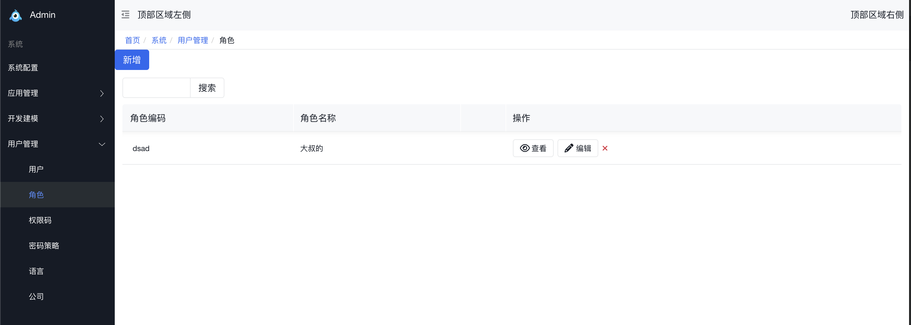

# ghost-LowCode
不想碰到新项目就重新来，通过业务模块的积累，能进行模块化安装。
我可以继承拥有别人的能力，也可以改写别人的能力。
新的项目只需要安装模块就能搭建一套完整的业务系统。
极大减少了代码量，降低了学习成本，并提升了用户体验。
除框架代码以外，ghost-LowCode的所有基础代码都以模块的形式组合在一起。这些模块可以随时从数据库中安装或卸载。这些模块有两大目的。要么你可以添加新应用/业务逻辑，要么你可以修改已有应用。简言之，ghost-LowCode中的一切都始于模块也终于模块。
ghost-LowCode由不同规模的公司所使用，每个公司都有不同的业务流和要求。处理这一问题，ghost-LowCode将应用的功能拆分到了不同的模块中。这些模块可按需在数据库中进行加载。基本上，用户可以在任何时间点启用/禁用这些功能。因此，相同的软件可以按不同的要求进行调整。查看下面模块的截屏；该列中第一个模块是主应用，其它的模块为该应用添加功能而设计。

## 功能介绍

支持热部署，一键部署发布。

支持模块化安装，需要使用什么业务就安装什么业务。

支持属性服务的继承、扩展。

继承，我可以拥有别人的属性，服务。

扩展，我可以改写别人的服务，从而使用我的服务。

支持注解自动生成CURD的能力.

## 版权申明

参考文献

[jFinal](https://github.com/jfinal/jfinal.git) 

[odoo](https://github.com/odoo/odoo.git)  

[jdoo](https://github.com/CSharpStudio/Jdoo.git)

## 版权信息

软件遵循[MIT](https://baike.baidu.com/item/MIT/10772952)开源协议，意味着您无需支付任何费用，也无需授权，即可将 软件应用到您的产品中。  
注意：这并不意味着您可以将软件应用到非法的领域，比如涉及赌博、色情、暴力、宗教等方面。
如因此产生纠纷等法律问题， 作者不承担任何责任。切勿以身试法!!! 网络不是法外之地
声明：软件仅供学习交流，严禁用于商业用途。

