# 知录Admin 产品功能文档

## 目录
- [产品概述](#产品概述)
- [核心功能模块](#核心功能模块)
  - [1. 工作流引擎](#1-工作流引擎)
  - [2. 表单设计器](#2-表单设计器)
  - [3. 表格设计器](#3-表格设计器)
  - [4. 电子签章系统](#4-电子签章系统)
  - [5. AI智能助手](#5-ai智能助手)
  - [6. 数据集管理](#6-数据集管理)
  - [7. 文件管理](#7-文件管理)
  - [8. 系统管理](#8-系统管理)
- [项目初始化](#项目初始化)
  - [环境要求](#环境要求)
  - [数据库初始化](#数据库初始化)
  - [后端项目初始化](#后端项目初始化)
  - [前端项目初始化](#前端项目初始化)
  - [配置文件说明](#配置文件说明)
  - [启动项目](#启动项目)
  - [访问系统](#访问系统)
- [功能截图说明](#功能截图说明)
- [使用指南](#使用指南)
- [技术架构](#技术架构)

---

## 产品概述

**知录Admin** 是一套超级简单的自研工作流引擎以及电子签章后台系统。系统采用现代化的低代码/零代码设计理念，告别了传统工作流系统（如 Flowable、Activiti）繁琐的 BPMN 配置，采用 JSON 交互方式实现流程定义，支持审批节点、条件分支节点等流程元素，打造现代化低代码或零代码平台的基础模型。

### 产品特色

- **简单易用**：告别 BPMN 复杂配置，使用 JSON 交互，降低学习成本
- **可视化设计**：表单、表格、流程都支持可视化拖拽设计
- **AI 赋能**：通过自然语言对话操作系统，降低使用门槛
- **模块化架构**：Maven 多模块设计，易于扩展和维护
- **现代化技术栈**：Vue3 + Spring Boot，紧跟技术潮流

---

## 核心功能模块

### 1. 工作流引擎

工作流引擎是系统的核心功能，支持企业级业务流程的自动化管理。

#### 1.1 流程设计器

- **可视化设计**：通过拖拽方式设计业务流程，直观易懂
- **节点类型支持**：
  - **开始节点**：流程的起始点
  - **审批节点**：需要人工审批的节点，支持指定审批人
  - **条件分支节点**：根据流程变量自动路由到不同分支
  - **结束节点**：流程的终止点
- **连线配置**：支持设置条件表达式，实现智能路由
- **流程变量**：支持流程变量定义，对应传统开发的 CRUD 实体字段

#### 1.2 流程实例管理

- **流程发起**：支持通过表单数据发起流程
- **任务审批**：审批人可以在待办任务中处理审批
- **流程跟踪**：实时查看流程执行进度和历史记录
- **流程状态**：支持运行中、已结束、已暂停等状态管理

#### 1.3 任务中心

- **我的待办**：查看分配给当前用户的待处理任务
- **我的已办**：查看已处理的历史任务
- **任务详情**：查看任务相关信息、流程进度、审批意见等

### 2. 表单设计器

表单设计器提供可视化的表单设计能力，支持多种表单组件。

#### 2.1 组件库

支持丰富的表单组件：
- **基础组件**：输入框、多行文本、数字输入
- **选择组件**：下拉选择、单选框、多选框
- **日期时间**：日期选择器、时间选择器
- **高级组件**：滑块、开关、评分、颜色选择器、文件上传

#### 2.2 设计功能

- **拖拽设计**：从组件面板拖拽组件到画布
- **属性配置**：选中组件后可在属性面板配置组件属性
- **实时预览**：设计过程中实时预览表单效果
- **表单保存**：保存表单设计，支持后续编辑

#### 2.3 表单数据管理

- **数据录入**：基于设计的表单进行数据录入
- **数据列表**：查看和管理表单数据
- **数据导出**：支持导出表单数据

### 3. 表格设计器

表格设计器用于设计数据列表的展示方式。

#### 3.1 列表配置

- **列配置**：自定义列表显示的列
- **排序设置**：支持多字段排序
- **筛选功能**：支持字段筛选和搜索
- **分页设置**：配置分页大小和样式

#### 3.2 操作按钮

- **自定义操作**：添加编辑、删除、查看等操作按钮
- **批量操作**：支持批量删除、批量导出等操作

### 4. 电子签章系统

电子签章系统提供完整的数字证书和电子签章解决方案。

#### 4.1 数字证书管理

- **证书生成**：支持生成 SM2、RSA 数字证书
- **证书颁发**：软证书生成和颁发功能
- **证书管理**：证书列表、查看、删除等管理功能
- **证书验证**：支持证书签名与验签

#### 4.2 印章管理

- **印章生成**：支持生成电子印章
- **印章样式**：自定义印章样式和内容
- **印章管理**：印章列表、查看、删除等管理功能

#### 4.3 PDF 电子盖章

- **PDF 预览**：在线预览 PDF 文件
- **位置选择**：点击 PDF 选择盖章位置
- **盖章操作**：选择证书和印章进行盖章
- **签署记录**：记录每次签署的详细信息
- **签署验证**：验证 PDF 文件的签名有效性

### 5. AI 智能助手

AI 智能助手基于阿里云通义千问（Qwen3-Max），提供智能化的系统操作体验。

#### 5.1 自然语言交互

- **对话式操作**：通过自然语言与系统交互
- **智能理解**：理解用户意图，自动执行相应操作
- **参数补全**：智能识别并补全操作所需的参数

#### 5.2 功能支持

- **API 扫描**：自动扫描系统 API，支持调用
- **系统操作**：通过对话操作系统所有功能
- **对话历史**：保存对话历史，支持上下文理解

#### 5.3 多模态支持

- **图片识别**：支持上传图片进行识别和分析
- **文件处理**：支持上传文件进行处理

### 6. 数据集管理

数据集管理提供数据源连接和数据管理能力。

#### 6.1 数据源管理

- **数据源配置**：配置数据库连接信息
- **连接测试**：测试数据源连接是否正常
- **多数据源支持**：支持配置多个数据源

#### 6.2 数据表管理

- **表结构查看**：查看数据表的结构信息
- **字段管理**：管理表字段和属性
- **数据预览**：预览数据表的数据

#### 6.3 数据集管理

- **数据集创建**：基于数据源创建数据集
- **表选择**：选择数据源中的表
- **数据查询**：支持自定义查询条件

#### 6.4 数据源导出

- **结构导出**：导出数据源的表结构
- **数据导出**：导出数据源的数据，支持多种格式

### 7. 文件管理

文件管理提供完整的文件上传、下载、预览和管理功能。

#### 7.1 文件上传

- **单文件上传**：支持单个文件上传
- **批量上传**：支持批量文件上传
- **上传进度**：显示文件上传进度

#### 7.2 文件预览

- **图片预览**：支持图片在线预览
- **PDF 预览**：支持 PDF 文件在线预览
- **Office 文档**：支持 Word、Excel 等 Office 文档预览

#### 7.3 文件编辑

- **OnlyOffice 集成**：基于 OnlyOffice 实现在线文档编辑
- **文档保存**：支持在线编辑并保存文档

#### 7.4 文件管理

- **文件列表**：查看所有上传的文件
- **文件搜索**：支持按文件名搜索
- **文件分类**：按文件类型分类显示
- **文件下载**：下载文件到本地
- **文件删除**：删除不需要的文件

### 8. 系统管理

系统管理提供用户、角色、权限等基础管理功能。

#### 8.1 用户管理

- **用户列表**：查看和管理系统用户
- **用户创建**：创建新用户
- **用户编辑**：编辑用户信息
- **用户删除**：删除用户

#### 8.2 角色管理

- **角色列表**：查看和管理系统角色
- **角色创建**：创建新角色
- **权限分配**：为角色分配权限

#### 8.3 菜单管理

- **菜单配置**：配置系统菜单结构
- **菜单权限**：设置菜单访问权限

#### 8.4 部门管理

- **部门树**：树形结构展示部门层级
- **部门管理**：创建、编辑、删除部门

#### 8.5 操作日志

- **日志记录**：记录用户操作行为
- **日志查询**：支持按条件查询日志
- **日志导出**：导出操作日志

---

## 项目初始化

### 环境要求

在开始项目初始化之前，请确保您的开发环境满足以下要求：

#### 后端环境要求

- **JDK**：Java 8 或更高版本
- **Maven**：3.6.0 或更高版本
- **MySQL**：MySQL 8.0 或更高版本
- **Redis**：Redis 5.0 或更高版本（可选，用于缓存和会话管理）

#### 前端环境要求

- **Node.js**：16.0 或更高版本（推荐使用 18.x LTS 版本）
- **npm**：8.0 或更高版本（或使用 yarn、pnpm）

#### 可选组件

- **OnlyOffice Document Server**：用于在线文档编辑功能（可选）

### 数据库初始化

1. **创建数据库**

   使用 MySQL 客户端连接到数据库服务器，创建数据库：

   ```sql
   CREATE DATABASE zapi_allin DEFAULT CHARACTER SET utf8mb4 COLLATE utf8mb4_unicode_ci;
   ```

2. **导入数据库脚本**

   数据库初始化脚本位于：
   ```
   zapi-allin-sys/allin-starter/src/main/resources/sql/zapi_allin.sql
   ```

   执行以下命令导入数据库：

   ```bash
   mysql -u root -p zapi_allin < zapi-allin-sys/allin-starter/src/main/resources/sql/zapi_allin.sql
   ```

   或者在 MySQL 客户端中执行：

   ```sql
   USE zapi_allin;
   SOURCE zapi-allin-sys/allin-starter/src/main/resources/sql/zapi_allin.sql;
   ```

3. **验证数据库**

   确认数据库表已创建成功，可以执行以下命令查看：

   ```sql
   SHOW TABLES;
   ```

### 后端项目初始化

1. **克隆或下载项目**

   获取项目代码到本地：

   ```bash
   git clone <项目地址>
   cd zapi-allin/zapi-allin-sys
   ```

2. **配置 Maven**

   确保 Maven 已正确配置，可以使用以下命令验证：

   ```bash
   mvn -version
   ```

3. **修改配置文件**

   编辑 `allin-starter/src/main/resources/application.yml` 文件，配置数据库和 Redis 连接信息：

   ```yaml
   spring:
     datasource:
       url: jdbc:mysql://127.0.0.1:3306/zapi_allin?useUnicode=true&characterEncoding=utf8&useSSL=false&serverTimezone=Asia/Shanghai
       username: root
       password: your_password  # 修改为您的数据库密码
     
     redis:
       host: 127.0.0.1
       port: 6379
       password: your_redis_password  # 如果有密码，请修改
       database: 0
   
   zapi:
     file:
       local:
         root-path: /path/to/your/file/storage  # 修改为您的文件存储路径
   ```

   **重要配置项说明：**

   - **数据库配置**：修改 `spring.datasource.url`、`username`、`password` 为您的数据库连接信息
   - **Redis 配置**：如果未安装 Redis，可以暂时注释掉 Redis 相关配置（部分功能可能受影响）
   - **文件存储路径**：修改 `zapi.file.local.root-path` 为实际的文件存储目录路径
   - **OnlyOffice 配置**：如果使用在线文档编辑功能，需要配置 OnlyOffice Document Server 地址
   - **AI 配置**：如需使用 AI 助手功能，需要配置阿里云通义千问 API Key

4. **编译项目**

   在项目根目录执行 Maven 编译命令：

   ```bash
   mvn clean install -DskipTests
   ```

   如果编译成功，会在 `allin-starter/target` 目录下生成可执行的 JAR 文件。

5. **验证依赖**

   确保所有依赖都已正确下载，可以执行：

   ```bash
   mvn dependency:resolve
   ```

### 前端项目初始化

1. **进入前端项目目录**

   ```bash
   cd zapi-allin-web
   ```

2. **安装依赖**

   使用 npm 安装项目依赖：

   ```bash
   npm install
   ```

   如果网络较慢，可以使用国内镜像：

   ```bash
   npm install --registry=https://registry.npmmirror.com
   ```

   或者使用 yarn：

   ```bash
   yarn install
   ```

3. **配置代理（开发环境）**

   编辑 `vite.config.js` 文件，配置后端 API 代理地址：

   ```javascript
   proxy: {
     '/zapi-allin-sys': {
       target: 'http://localhost:8080',  // 修改为您的后端服务地址
       changeOrigin: true,
       secure: false
     }
   }
   ```

4. **配置 API 地址（生产环境）**

   如果部署到生产环境，需要修改 `src/config/index.js` 中的 API 基础地址：

   ```javascript
   export const API_CONFIG = {
     BASE_URL: '/zapi-allin-sys',  // 根据实际部署情况修改
     // ...
   }
   ```

### 配置文件说明

#### 后端配置文件

主要配置文件：`zapi-allin-sys/allin-starter/src/main/resources/application.yml`

**关键配置项：**

- **服务器配置**
  - `server.port`：后端服务端口（默认：8080）
  - `server.servlet.context-path`：应用上下文路径（默认：/zapi-allin-sys）

- **数据库配置**
  - `spring.datasource.url`：数据库连接 URL
  - `spring.datasource.username`：数据库用户名
  - `spring.datasource.password`：数据库密码

- **Redis 配置**
  - `spring.redis.host`：Redis 服务器地址
  - `spring.redis.port`：Redis 端口
  - `spring.redis.password`：Redis 密码（可选）

- **文件服务配置**
  - `zapi.file.local.root-path`：本地文件存储根路径
  - `zapi.file.upload.max-file-size`：最大文件上传大小（MB）

- **AI 配置**
  - `ai.qwen.enabled`：是否启用 AI 功能
  - `ai.qwen.api-key`：阿里云通义千问 API Key
  - `ai.qwen.model`：使用的 AI 模型

- **OnlyOffice 配置**
  - `onlyoffice.document-server-url`：OnlyOffice 文档服务器地址
  - `onlyoffice.jwt-secret`：JWT 密钥
  - `onlyoffice.frontend-url`：前端页面地址

#### 前端配置文件

主要配置文件：`zapi-allin-web/vite.config.js` 和 `zapi-allin-web/src/config/index.js`

**关键配置项：**

- **开发服务器配置**（`vite.config.js`）
  - `server.port`：前端开发服务器端口（默认：5173）
  - `server.proxy`：API 代理配置

- **API 配置**（`src/config/index.js`）
  - `API_CONFIG.BASE_URL`：后端 API 基础路径

### 启动项目

#### 启动后端服务

1. **方式一：使用 IDE 启动**

   在 IDE（如 IntelliJ IDEA、Eclipse）中打开项目，找到启动类：
   ```
   com.zapi.ZapiApplication
   ```
   右键选择 "Run" 或 "Debug" 启动项目。

2. **方式二：使用 Maven 启动**

   ```bash
   cd zapi-allin-sys/allin-starter
   mvn spring-boot:run
   ```

3. **方式三：使用 JAR 包启动**

   先打包项目：

   ```bash
   cd zapi-allin-sys
   mvn clean package -DskipTests
   ```

   然后运行生成的 JAR 文件：

   ```bash
   java -jar allin-starter/target/allin-starter-1.0.0.jar
   ```

4. **验证后端启动**

   启动成功后，可以通过以下方式验证：

   - 访问 Swagger 文档：`http://localhost:8080/zapi-allin-sys/swagger-ui/index.html`
   - 访问健康检查接口：`http://localhost:8080/zapi-allin-sys/actuator/health`（如果配置了 Actuator）

#### 启动前端服务

1. **开发环境启动**

   ```bash
   cd zapi-allin-web
   npm run dev
   ```

   启动成功后，控制台会显示访问地址，通常是：`http://localhost:5173`

2. **生产环境构建**

   ```bash
   cd zapi-allin-web
   npm run build
   ```

   构建完成后，静态文件会生成在 `dist` 目录下，可以部署到 Nginx、Apache 等 Web 服务器。

3. **预览生产构建**

   ```bash
   npm run preview
   ```

### 访问系统

1. **打开浏览器**

   在浏览器中访问前端地址（开发环境通常是 `http://localhost:5173`）

2. **登录系统**

   - 默认管理员账号和密码请查看数据库初始化脚本或联系系统管理员
   - 首次登录建议修改默认密码

3. **系统功能验证**

   登录成功后，可以验证以下功能：

   - **仪表板**：查看系统统计信息
   - **工作流管理**：创建和设计工作流
   - **表单管理**：创建和设计表单
   - **系统管理**：管理用户、角色、菜单等
   - **文件管理**：上传和管理文件
   - **AI 助手**：使用 AI 功能（需配置 API Key）

### 常见问题

#### 1. 数据库连接失败

**问题**：启动后端时提示数据库连接失败

**解决方案**：
- 检查 MySQL 服务是否启动
- 检查数据库连接配置是否正确（用户名、密码、端口）
- 确认数据库 `zapi_allin` 已创建
- 检查防火墙设置

#### 2. Redis 连接失败

**问题**：启动时提示 Redis 连接失败

**解决方案**：
- 如果未安装 Redis，可以暂时注释掉 Redis 相关配置
- 如果已安装，检查 Redis 服务是否启动
- 检查 Redis 连接配置（地址、端口、密码）

#### 3. 前端无法连接后端

**问题**：前端页面无法访问后端 API

**解决方案**：
- 检查后端服务是否正常启动
- 检查 `vite.config.js` 中的代理配置是否正确
- 检查后端服务地址和端口是否正确
- 检查浏览器控制台的错误信息

#### 4. 文件上传失败

**问题**：文件上传功能无法使用

**解决方案**：
- 检查文件存储路径配置是否正确
- 确认存储路径有读写权限
- 检查文件大小是否超过限制
- 检查文件类型是否在允许列表中

#### 5. AI 功能无法使用

**问题**：AI 助手无法正常工作

**解决方案**：
- 检查 `application.yml` 中 AI 配置是否正确
- 确认已配置有效的阿里云通义千问 API Key
- 检查网络连接是否正常
- 查看后端日志中的错误信息

---

## 功能截图说明

### 登录页面

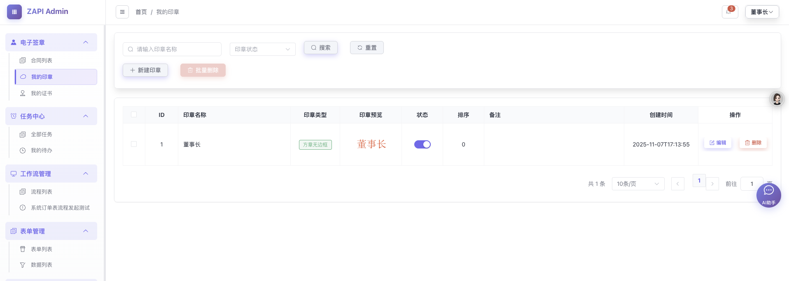

系统登录页面，支持用户名密码登录。

### 仪表板

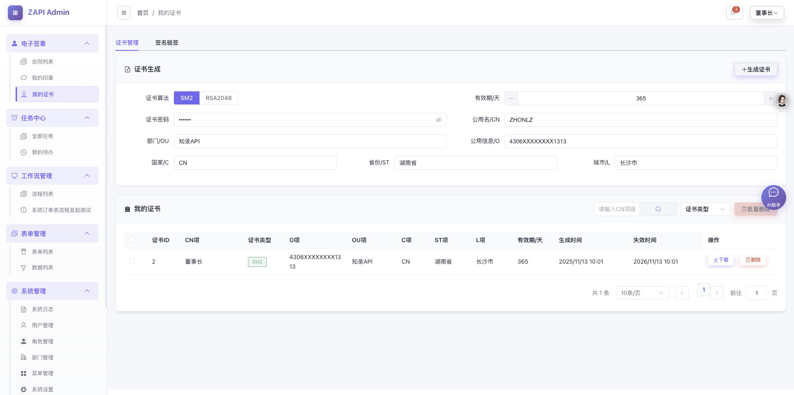

系统首页仪表板，展示系统统计信息和快捷入口。

### 工作流设计器

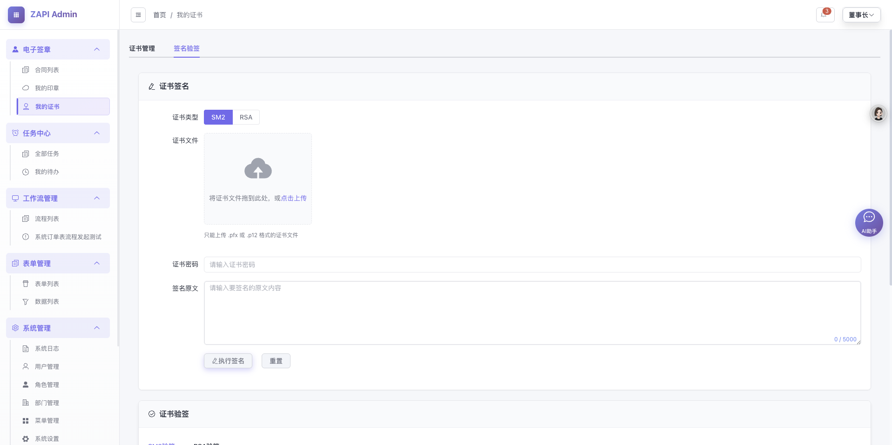

可视化工作流设计器，支持拖拽设计流程节点和连线。

### 工作流设计器详情

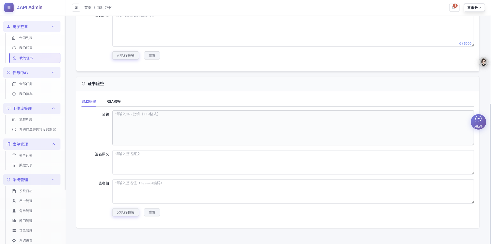

工作流设计器的详细界面，显示节点配置和属性设置。

### 表单设计器

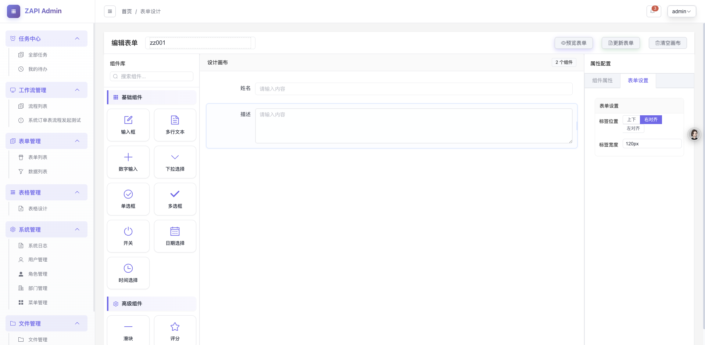

可视化表单设计器，支持拖拽组件设计表单。

### 表单组件

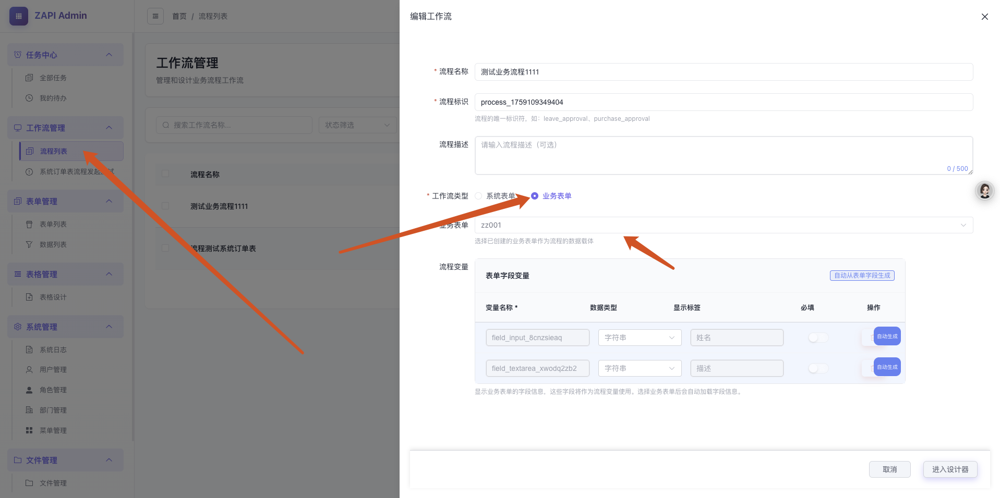

表单设计器的组件面板，展示可用的表单组件。

### 表单属性配置

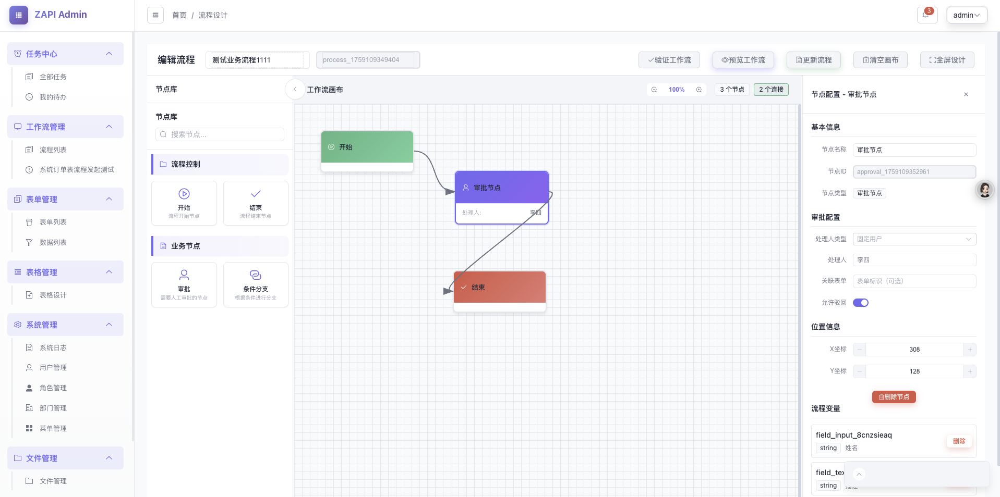

表单组件的属性配置面板，可以设置组件的各种属性。

### 表单预览

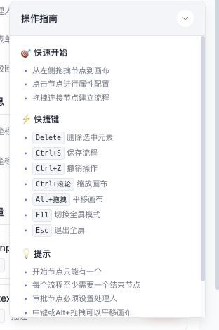

表单预览功能，实时查看表单设计效果。

### 电子签章

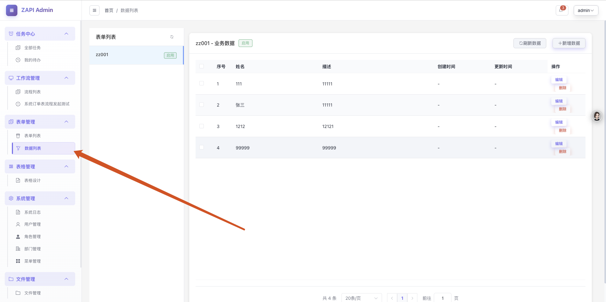

PDF 电子盖章界面，支持选择证书和印章进行盖章。

### AI 助手

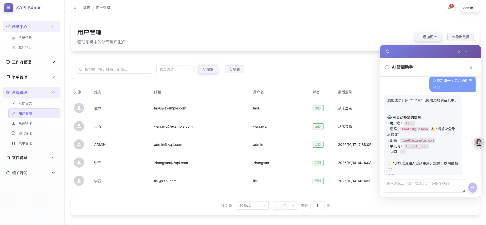

AI 智能助手界面，支持自然语言对话操作系统。

### 其他功能


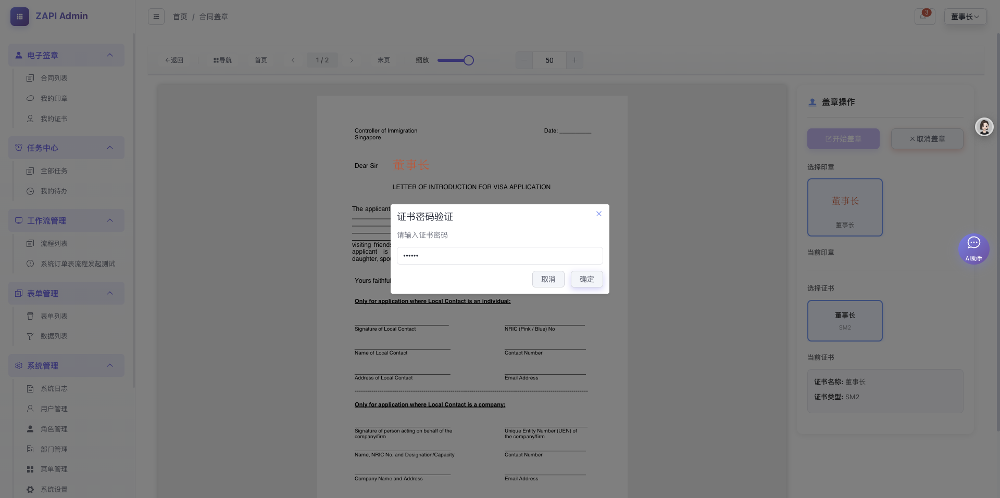

---

## 使用指南

### 业务表单发起流程

1. **创建表单**
   - 进入"表单管理" → "表单列表"
   - 点击"创建表单"按钮
   - 使用表单设计器设计表单
   - 保存表单

2. **创建流程**
   - 进入"工作流管理" → "流程列表"
   - 点击"创建流程"按钮
   - 使用流程设计器设计流程
   - 配置流程节点和连线
   - 保存流程

3. **关联表单和流程**
   - 在流程配置中关联对应的表单
   - 设置流程变量与表单字段的映射关系

4. **发起流程**
   - 进入"表单管理" → "数据列表"
   - 选择对应的表单
   - 点击"新增"按钮
   - 填写表单数据并提交
   - 系统自动发起工作流

### 系统表单操作

系统内置了系统表单的流程定义，流程变量对应传统开发的 CRUD 实体字段。

1. 进入流程设计器
2. 选择系统表单流程
3. 配置流程节点和审批人
4. 在数据列表中进行新增数据以发起工作流

### 电子签章操作

1. **生成证书**
   - 进入"证书管理"
   - 点击"生成证书"
   - 填写证书信息
   - 设置证书密码
   - 生成并下载证书

2. **生成印章**
   - 进入"印章管理"
   - 点击"生成印章"
   - 设置印章样式和内容
   - 保存印章

3. **PDF 盖章**
   - 进入"合同管理" → "合同盖章"
   - 上传或选择 PDF 文件
   - 选择证书和印章
   - 在 PDF 上点击选择盖章位置
   - 输入证书密码
   - 完成盖章

### AI 助手使用

1. 进入"AI 助手"页面
2. 在输入框中输入自然语言指令
3. AI 助手会理解指令并执行相应操作
4. 可以上传图片或文件进行多模态交互
5. 查看对话历史，支持上下文理解

---

## 技术架构

### 前端技术栈

- **框架**：Vue 3.3.4
- **构建工具**：Vite 4.4.5
- **UI 库**：Element Plus 2.3.8
- **状态管理**：Pinia 2.1.6
- **路由**：Vue Router 4.2.4
- **代码编辑器**：Monaco Editor 0.53.0
- **文档编辑**：OnlyOffice Document Editor Vue 1.6.1
- **PDF 预览**：PDF.js 2.2.228

### 后端技术栈

- **框架**：Spring Boot 2.7.18
- **ORM**：MyBatis Plus
- **数据库**：MySQL 8
- **构建工具**：Maven
- **架构模式**：多模块 Maven 项目

#### 模块结构

- **allin-common**：公共工具类和基础组件
- **allin-model**：业务模型层
  - **allin-model-ai**：AI 功能模块
  - **allin-model-contract**：合同管理模块
  - **allin-model-dataset**：数据集管理模块
  - **allin-model-form**：表单管理模块
  - **allin-model-notification**：通知管理模块
  - **allin-model-onlyoffice**：OnlyOffice 集成模块
  - **allin-model-system**：系统管理模块
  - **allin-model-workflow**：工作流模块
- **allin-support**：支撑服务
  - **allin-support-file**：文件服务
  - **allin-support-redis**：Redis 服务
  - **allin-support-swagger**：Swagger 文档
- **allin-starter**：启动模块

### 核心特性

- **工作流引擎**：自研工作流引擎，采用 JSON 配置，支持审批节点、条件分支节点
- **数字证书**：支持 SM2、RSA 数字证书生成、签名与验签
- **电子签章**：PDF 电子盖章功能，支持位置选择和签署记录
- **AI 集成**：集成阿里云通义千问，提供智能助手功能
- **可视化设计**：表单设计器、表格设计器、流程设计器

---

## 总结

知录Admin 是一个功能完善的企业级低代码平台，集成了工作流引擎、电子签章、表单设计、AI 助手等核心功能。系统采用现代化的技术栈和设计理念，提供了简单易用的操作体验，能够满足企业各种业务流程管理需求。

通过可视化的设计器和智能化的 AI 助手，用户可以快速构建业务流程、设计表单、管理数据，大大提高了工作效率和系统易用性。

---

**文档版本**：v1.0.0  
**最后更新**：2025年  

